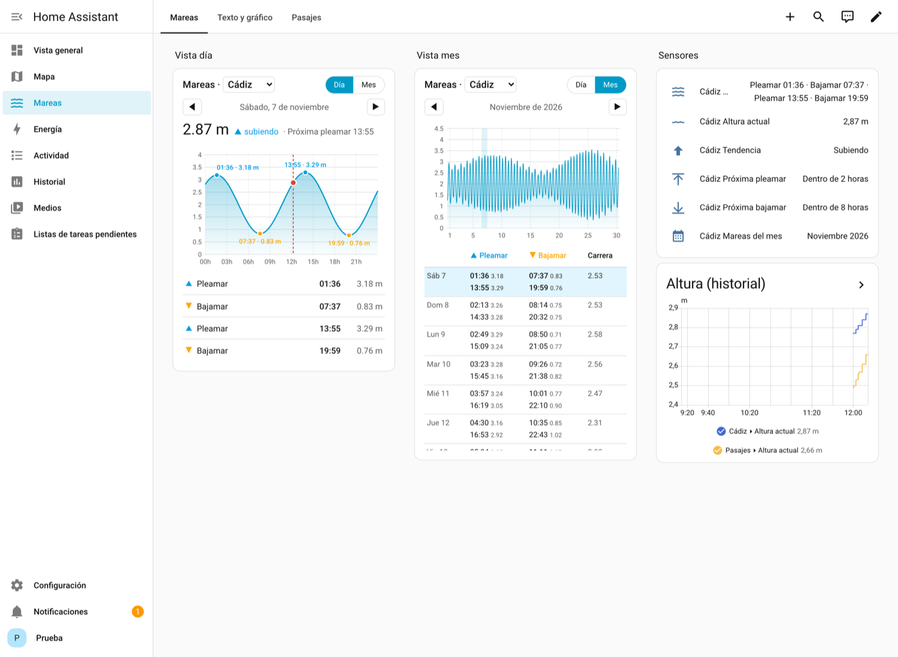
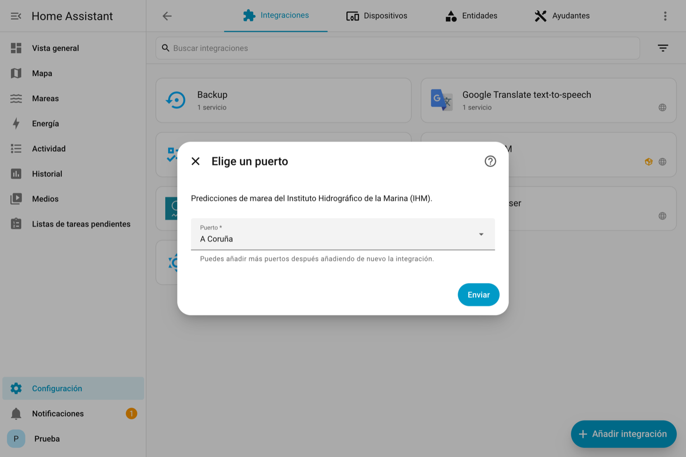
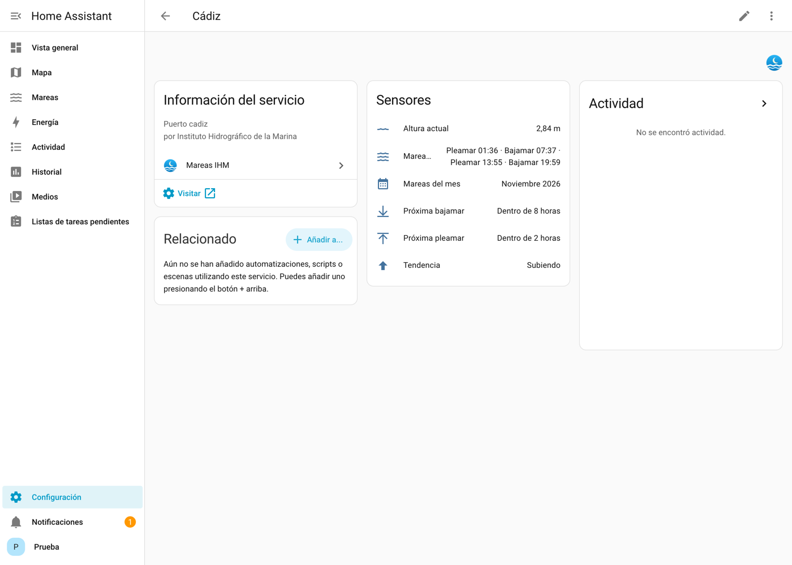
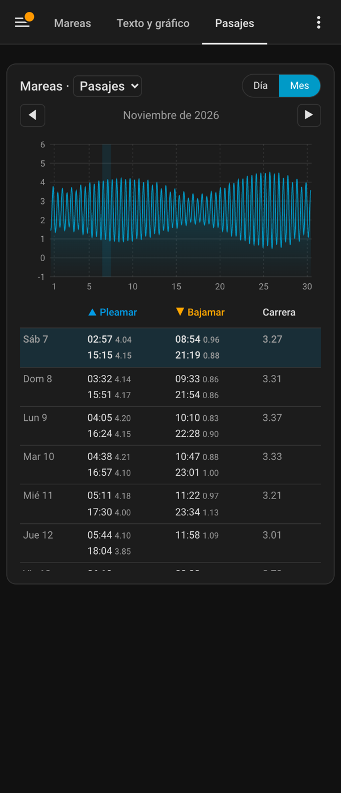
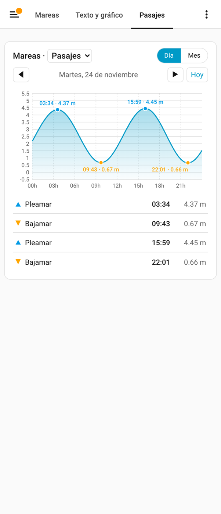

# IHM Tides for Home Assistant

🇪🇸 [Español](README.md)

High tides, low tides and water height for ports in Spain, using official
data from the **Instituto Hidrográfico de la Marina (IHM)**, the Spanish
Navy Hydrographic Institute. It ships with its own card to show the tides
for the **day** or the **month**, as **text**, as a **chart**, or both.



## Features

- **70 ports** to choose from a list (you can add several).
- **Sensors** for each port:

  | Sensor | Example |
  |---|---|
  | Tides today | `High tide 01:36 · Low tide 07:37 · High tide 13:55 · Low tide 19:59` |
  | Tides this month | `November 2026` (with every tide of the month as an attribute) |
  | Current height | `2.77 m` (recalculated every 5 minutes) |
  | Trend | `Rising` / `Falling` |
  | Next high tide | date and time, with the height as an attribute |
  | Next low tide | date and time, with the height as an attribute |

- **`custom:mareas-card` card**: day and month views, ◀ ▶ navigation through
  any day or month of the year, port selector, visual editor, and light/dark
  mode. It is installed automatically with the integration, so there is no
  need to add dashboard resources by hand.
- **`mareas_ihm.consultar_mareas` action** for automations.

## Installation

### From the Marketplace (Home Assistant 2026.11 or later)

[](https://my.home-assistant.io/redirect/hacs_repository/?owner=pqrs&repository=ha-mareas-ihm&category=integration)

1. Go to **Settings → Marketplace**, search for "Mareas IHM" and click
   **Install**. If it is not in the catalog yet: ⋮ menu → **Custom
   repositories**, paste `https://github.com/pqrs/ha-mareas-ihm` and choose
   type *Integration*.
2. The setup wizard opens straight away. Choose the port.

### Manual

Copy the `custom_components/mareas_ihm` folder into the `custom_components`
folder of your configuration and restart Home Assistant.

## Configuration

[](https://my.home-assistant.io/redirect/config_flow_start/?domain=mareas_ihm)

Go to **Settings → Devices & services → Add integration → Mareas IHM** and
choose the port. To add more ports, repeat the process.



Options (the integration's **Configure** button):

- **Daily chart resolution**: minutes between points of the curve (5–60).
- **Create the monthly tides sensor**: needed for the month view without a
  connection. If you turn it off, the card asks the IHM for the month when
  you open it.



## Card

```yaml
type: custom:mareas-card
puerto: <device id>      # optional; defaults to the first port
vista: dia               # dia (day) | mes (month)
mostrar: ambos           # ambos (both) | texto (text) | grafico (chart)
selector_puerto: true    # drop-down to switch ports
titulo: Tides            # optional
```

The option names are in Spanish; the values are shown in brackets above.
You can also add the card from **Edit dashboard → Add card → Mareas** and
set it up with the visual editor. Tap a day in the month table to see it
in detail.

| Month (dark mode) | Day |
|---|---|
|  |  |

## Action for automations

```yaml
action: mareas_ihm.consultar_mareas
data:
  puerto_id: "42"        # puerto_id attribute of any sensor of the port
  fecha: "2026-12-25"    # a day (fecha), or instead a month:  mes: "2026-12"
response_variable: mareas
```

Example: a notification 1 hour before low tide.

```yaml
triggers:
  - trigger: time
    at:
      entity_id: sensor.cadiz_proxima_bajamar
      offset: "-01:00:00"
actions:
  - action: notify.notify
    data:
      message: >-
        Low tide in Cádiz at
        {{ as_timestamp(states('sensor.cadiz_proxima_bajamar')) | timestamp_custom('%H:%M') }}
        ({{ state_attr('sensor.cadiz_proxima_bajamar', 'altura') }} m)
```

Entity IDs are created in your Home Assistant's language. With Home
Assistant in English they will be named like `sensor.cadiz_next_low_tide`
instead; check yours in **Settings → Devices & services → Mareas IHM**.

## Notes

- The IHM API returns times in **UTC**; the integration converts them to
  your Home Assistant's time zone (including daylight saving changes).
- The IHM only publishes predictions for the **current year**.
- The height between high and low tide is calculated with a half cosine
  wave, the same method used by the official IHM chart (difference < 1 mm).
- Predictions are for guidance only: **not valid for navigation**.

Data: © Instituto Hidrográfico de la Marina. Unofficial project, not
affiliated with the IHM or the Spanish Navy.

## Bugs and suggestions

If something does not work or you have an idea, open an issue on
[GitHub Issues](https://github.com/pqrs/ha-mareas-ihm/issues) with your
Home Assistant version, the integration version and the port. If there are
errors, include what **Settings → System → Logs** shows when you search for
`mareas_ihm`.

## Development

```bash
python -m pytest tests -v      # tests
ruff check custom_components   # linting
```

MIT license.
