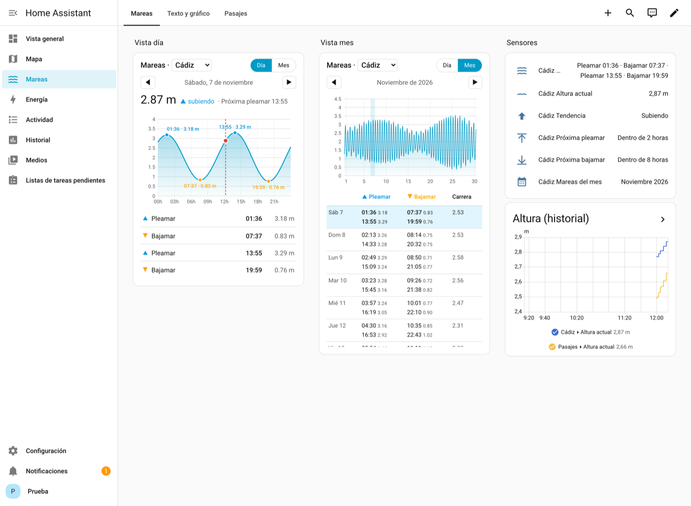
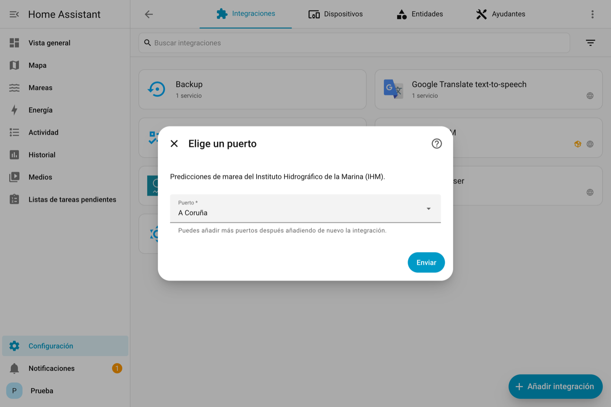
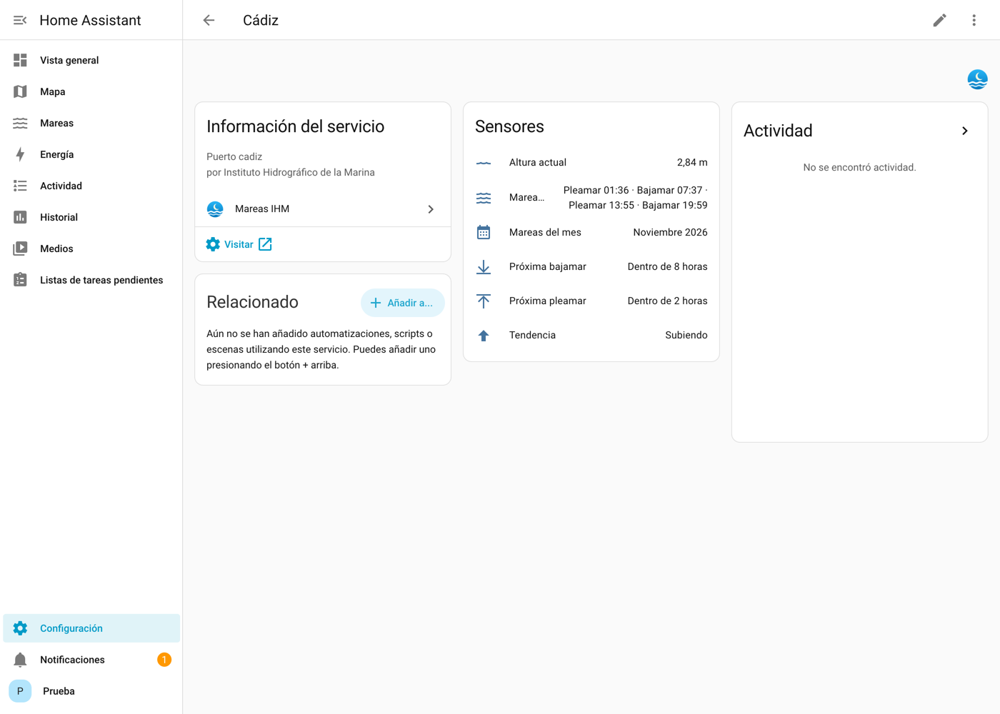
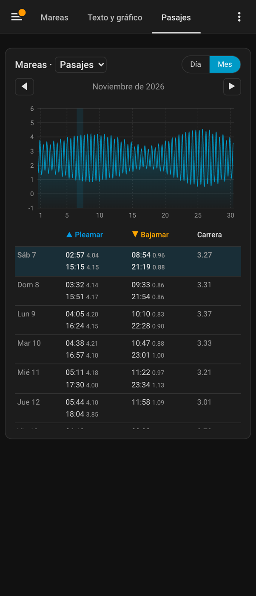
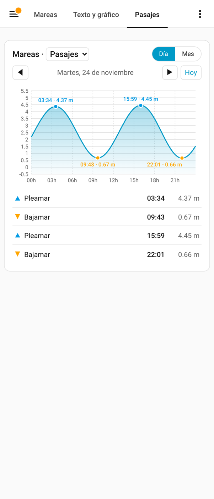

# Mareas IHM para Home Assistant

Pleamares, bajamares y altura del agua en los puertos de España, con datos
oficiales del **Instituto Hidrográfico de la Marina (IHM)**. Incluye una
tarjeta propia para ver las mareas del **día** o del **mes**, en **texto**,
en **gráfico** o en ambos a la vez.



## Qué incluye

- **70 puertos** para elegir de una lista (puedes añadir varios).
- **Sensores** por puerto:

  | Sensor | Ejemplo |
  |---|---|
  | Mareas de hoy | `Pleamar 01:36 · Bajamar 07:37 · Pleamar 13:55 · Bajamar 19:59` |
  | Mareas del mes | `Noviembre 2026` (con todas las mareas del mes como atributo) |
  | Altura actual | `2.77 m` (se recalcula cada 5 minutos) |
  | Tendencia | `subiendo` / `bajando` |
  | Próxima pleamar | fecha y hora, con la altura como atributo |
  | Próxima bajamar | fecha y hora, con la altura como atributo |

- **Tarjeta `custom:mareas-card`**: vista día y mes, navegación ◀ ▶ por
  cualquier día o mes del año, selector de puerto, editor visual y modo
  claro/oscuro. Se instala sola con la integración, sin añadir recursos a mano.
- **Acción `mareas_ihm.consultar_mareas`** para usar en automatizaciones.

## Instalación

### Desde el Marketplace (Home Assistant 2026.11 o posterior)

[](https://my.home-assistant.io/redirect/hacs_repository/?owner=pqrs&repository=ha-mareas-ihm&category=integration)

1. **Ajustes → Marketplace**, busca «Mareas IHM» y pulsa **Instalar**.
   Si aún no está en el catálogo: menú ⋮ → **Repositorios personalizados**,
   pega `https://github.com/pqrs/ha-mareas-ihm`, tipo *Integración*.
2. Se abre directamente el asistente de configuración. Elige el puerto.

### Manual

Copia la carpeta `custom_components/mareas_ihm` dentro de la carpeta
`custom_components` de tu configuración y reinicia Home Assistant.

## Configuración

[](https://my.home-assistant.io/redirect/config_flow_start/?domain=mareas_ihm)

**Ajustes → Dispositivos y servicios → Añadir integración → Mareas IHM**, y
elige el puerto. Para tener más puertos, repite el proceso.



Opciones (botón **Configurar** de la integración):

- **Resolución del gráfico diario**: minutos entre puntos de la curva (5–60).
- **Crear el sensor de mareas del mes**: necesario para la vista mensual sin
  conexión. Si lo desactivas, la tarjeta pide el mes al IHM cuando lo abres.



## Tarjeta

```yaml
type: custom:mareas-card
puerto: <id del dispositivo>   # opcional; por defecto, el primero
vista: dia                     # dia | mes
mostrar: ambos                 # ambos | texto | grafico
selector_puerto: true          # desplegable para cambiar de puerto
titulo: Mareas                 # opcional
```

También puedes añadirla desde **Editar panel → Añadir tarjeta → Mareas** y
configurarla con el editor visual. Pulsa un día de la tabla mensual para verlo
en detalle.

| Mes (modo oscuro) | Día |
|---|---|
|  |  |

## Acción para automatizaciones

```yaml
action: mareas_ihm.consultar_mareas
data:
  puerto_id: "42"        # atributo puerto_id de cualquier sensor del puerto
  fecha: "2026-12-25"    # o bien  mes: "2026-12"
response_variable: mareas
```

Ejemplo: aviso 1 hora antes de la bajamar.

```yaml
triggers:
  - trigger: time
    at:
      entity_id: sensor.cadiz_proxima_bajamar
      offset: "-01:00:00"
actions:
  - action: notify.notify
    data:
      message: >-
        Bajamar en Cádiz a las
        {{ as_timestamp(states('sensor.cadiz_proxima_bajamar')) | timestamp_custom('%H:%M') }}
        ({{ state_attr('sensor.cadiz_proxima_bajamar', 'altura') }} m)
```

## Notas

- La API del IHM devuelve las horas en **UTC**; la integración las convierte
  a la zona horaria de tu Home Assistant (incluidos los cambios de hora).
- El IHM solo publica predicciones del **año en curso**.
- La altura entre pleamar y bajamar se calcula con una media onda de coseno,
  el mismo método que usa el gráfico oficial del IHM (diferencia < 1 mm).
- Predicciones orientativas: **no válidas para la navegación**.

Datos: © Instituto Hidrográfico de la Marina. Proyecto no oficial, sin
relación con el IHM ni con la Armada.

## Desarrollo

```bash
python -m pytest tests -v      # pruebas
ruff check custom_components   # estilo
```

Licencia MIT.
